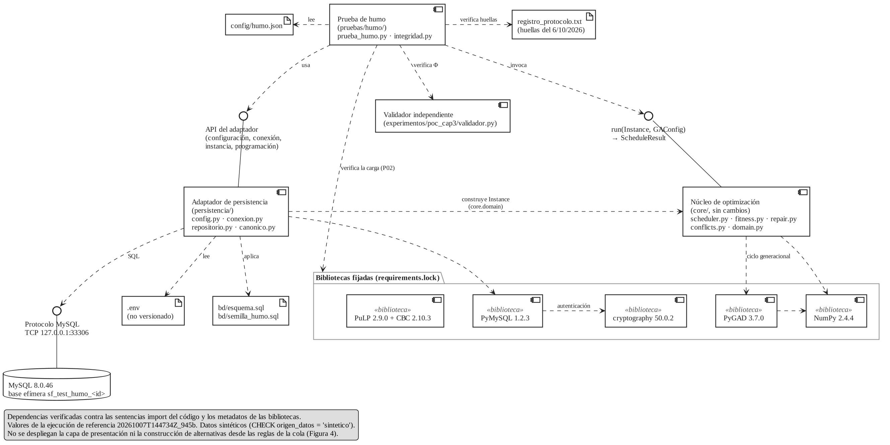
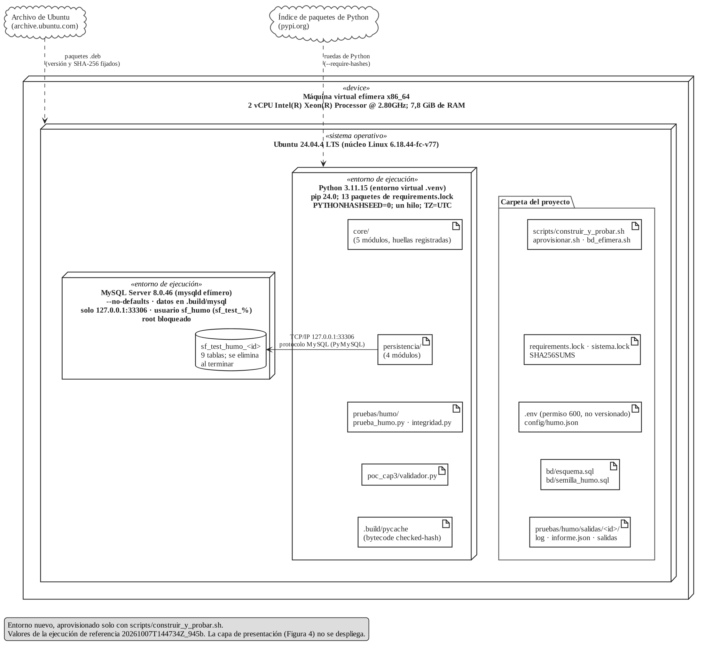

# Manual de compilación determinista del prototipo

**Sistema de asignación de recursos basado en algoritmo genético — Empresa de Transportes y Turismo San Felipe S.A.C.**
Seminario de Investigación 2 · Sesión 8 (Despliegue y pruebas preliminares) · Actividad 3

| Dato | Valor |
|---|---|
| Versión del manual | 1.0 |
| Ejecución de referencia | 7 de octubre de 2026, 14:47 (UTC), identificador `20261007T144734Z_945b` |
| Resultado de la ejecución de referencia | **PASA (12 de 12 pasos)** (prueba de humo, actividad 1) |
| Plataforma verificada | Ubuntu 24.04.4 LTS (x86_64), Python 3.11.15, MySQL 8.0.46 |
| Estado del repositorio | Integrado en el repositorio del sistema el 4/11/2026, con las adaptaciones de la sección 13; verificado ese día en otro equipo (PASA, 12 de 12, misma huella de salida). |

## 1. Propósito y alcance

Este manual permite reconstruir, desde cero y solo con los scripts del proyecto, el entorno de ejecución del prototipo y obtener **el mismo resultado byte a byte** que en la ejecución de referencia. En Python no se genera un ejecutable; aquí «compilar» significa cuatro operaciones encadenadas y verificables:

1. aprovisionar el sistema con versiones exactas (sistema operativo, Python y MySQL);
2. instalar las dependencias de Python con versión y huella SHA-256 fijadas;
3. compilar el código a *bytecode* de forma determinista;
4. verificar la construcción con las pruebas unitarias del núcleo y con la prueba de humo.

**Qué se construye (arquitectura materializada, sección 9):** el núcleo de optimización (`core/`, sin cambios y con huellas registradas), el adaptador de persistencia (`persistencia/`), una base de datos MySQL de pruebas efímera, la prueba de humo (`pruebas/humo/`) y el validador independiente de restricciones duras (`experimentos/poc_cap3/validador.py`).

**Qué no se construye todavía:** la capa de presentación, la construcción de las alternativas admisibles a partir de las reglas de la cola (lógica de negocio de la Figura 4 de la tesis), la carga de datos reales de la empresa (el registro RD-01 está pendiente de validación) y la caracterización del consumo de recursos con diez o más ejecuciones (actividad 2 de la sesión, no incluida en esta entrega).

## 2. Fuentes de variación y cómo se controlan

| Fuente de variación | Control aplicado | Dónde |
|---|---|---|
| Versión del sistema operativo y de MySQL | Ubuntu 24.04 LTS (amd64); paquetes con versión exacta y huella SHA-256 del archivo `.deb` | `sistema.lock`, paso A2 |
| Versión de Python | 3.11.15 exacta; entorno virtual nuevo en cada construcción | paso A3 |
| Dependencias de Python, incluidas las transitivas | 13 paquetes con versión exacta y 251 huellas; instalación con `--require-hashes --no-deps --only-binary=:all:` | `requirements.in` → `requirements.lock`, paso A4 |
| Código fuente | `SHA256SUMS` (todos los archivos del paquete) y `registro_protocolo.txt` (14 archivos del experimento registrado) | paso A1; pasos P01 y P12 |
| *Bytecode* | `compileall` en modo *checked-hash* (sin fechas de archivo), con rutas relativas y fuera del árbol de fuentes | `scripts/compilar.py`, paso A5 |
| Aleatoriedad | Semillas fijas (instancia 9001 y algoritmo genético 9001), `PYTHONHASHSEED=0` y pares en conflicto ordenados en el núcleo | `config/humo.json`, `scripts/entorno_determinista.sh` |
| Paralelismo | Un hilo: `OMP_NUM_THREADS`, `OPENBLAS_NUM_THREADS`, `MKL_NUM_THREADS` y `NUMEXPR_NUM_THREADS` = 1; CBC con un hilo | `scripts/entorno_determinista.sh`; CBC en `pruebas/humo/prueba_humo.py` |
| Reloj y configuración regional | Sin límites por tiempo de reloj en la configuración (`time_limit = null`); `TZ=UTC`; `LC_ALL=C.UTF-8` | `config/humo.json` (`time_limit`); `scripts/entorno_determinista.sh` (`TZ`, `LC_ALL`) |
| Configuraciones residuales | Entorno virtual sin paquetes del sistema; `PYTHONNOUSERSITE=1`; `PIP_CONFIG_FILE=/dev/null`; `mysqld --no-defaults`; directorio de datos nuevo | scripts del proyecto |
| Credenciales y rutas | `.env` no versionado, generado localmente; el código no contiene contraseñas, rutas de base de datos ni URI de conexión | `persistencia/config.py` |
| Datos de prueba | Archivo SQL estático con huella registrada; restricción `CHECK` que solo admite datos sintéticos | `bd/semilla_humo.sql`, `bd/esquema.sql` |

## 3. Entorno de referencia

Valores leídos de la ejecución de referencia (`informe.json` y `.build/construccion.json`); no se escribieron a mano.

| Elemento | Valor de referencia |
|---|---|
| Equipo | Máquina virtual Linux efímera en la nube, x86_64; 2 vCPU Intel(R) Xeon(R) Processor @ 2.80GHz; 7,8 GiB de RAM (8 223 864 KiB) |
| Sistema operativo | Ubuntu 24.04.4 LTS; núcleo Linux 6.18.44-fc-v77; `Linux-6.18.44-fc-v77-x86_64-with-glibc2.39` |
| Python | CPython 3.11.15 (paquete `python3.11` 3.11.15-1+noble1); en `.venv`: pip 24.0 y setuptools 79.0.1, incluidos por `ensurepip` |
| Servidor de base de datos | MySQL Server 8.0.46-0ubuntu0.24.04.4 (paquetes `-core` del archivo de Ubuntu) |
| Solucionador de PLE | CBC 2.10.3 (incluido en PuLP 2.9.0) |
| Dependencias de Python | 13 paquetes de `requirements.lock` (sección 4.2) |
| Variables de determinismo | `MKL_NUM_THREADS=1`, `OMP_NUM_THREADS=1`, `OPENBLAS_NUM_THREADS=1`, `PYTHONHASHSEED=0`, `PYTHONNOUSERSITE=1`, `TZ=UTC` |
| Construcción (paso A5) | 2026-10-07T14:47:27 UTC; 17 módulos compilados |

## 4. Manifiestos de dependencias

### 4.1 Sistema operativo (`sistema.lock`)

| Paquete | Versión exacta | SHA-256 del `.deb` |
|---|---|---|
| `python3.11` | 3.11.15-1+noble1 | requisito previo (sección 6.1) |
| `python3.11-venv` | 3.11.15-1+noble1 | requisito previo (sección 6.1) |
| `libaio1t64` | 0.3.113-6build1.1 | `433212b33e26d424605c01cec1de33b63f2cc12870987b4cb7b3625baba66a19` |
| `libevent-core-2.1-7t64` | 2.1.12-stable-9ubuntu2.2 | `2a5264b572f5fe50fc9d63e115d308c79b9fb746d13cc55b5ea1f0f01a78daa7` |
| `libevent-2.1-7t64` | 2.1.12-stable-9ubuntu2.2 | `083ced6efb23476cb4de4e441b741af02db5653e67fa7fcd6cf7e5f7b78f6101` |
| `libevent-pthreads-2.1-7t64` | 2.1.12-stable-9ubuntu2.2 | `0adf5bc30f0326ad4aa36541f4dfa4a0d5f42c5564f74c0112caf8b3c13a7fbb` |
| `libmecab2` | 0.996-14ubuntu4 | `cc91804dc82ac766833a97288384b7b65762aa26212bb915a556e13430c61745` |
| `libprotobuf-lite32t64` | 3.21.12-8.2ubuntu0.3 | `81610486f3ecf2fba6596930c4c5381f38a7929de83d0f67780c10ff3de03d12` |
| `mysql-server-core-8.0` | 8.0.46-0ubuntu0.24.04.4 | `a12f80479f2ba37b88670ecff246584fa8d27251104d2e5066777c4ea73d8d32` |
| `mysql-client-core-8.0` | 8.0.46-0ubuntu0.24.04.4 | `0a83b500effa91ce7f7eb3f2c9c8b6e284c51230850dc0dd3b2b25dd54d624a5` |

Solo se instalan los binarios del servidor y del cliente (paquetes `-core`) y sus bibliotecas: no se instala el servicio `mysql` del sistema ni se toca ninguna base existente. En la ejecución de referencia, los dos paquetes de Python ya estaban en la versión fijada; el paso A2 descargó los ocho archivos `.deb` restantes, verificó su huella y los instaló en una sola transacción de apt: seis paquetes nuevos y la actualización de `libevent-core-2.1-7t64` y `libevent-2.1-7t64` de 2.1.12-stable-9ubuntu2 a 2.1.12-stable-9ubuntu2.2, porque `libevent-pthreads-2.1-7t64` exige esa versión exacta.

### 4.2 Python (`requirements.lock`)

`requirements.lock` se generó con `pip-compile` (pip-tools 7.6.2) sobre CPython 3.11 en Linux, a partir de `requirements.in`:

```bash
pip-compile --generate-hashes --strip-extras --no-emit-index-url \
            --output-file=requirements.lock requirements.in
```

| Paquete | Versión | Fijación | Uso en el despliegue |
|---|---|---|---|
| `cffi` | 2.1.1 | transitiva | Requerido por cryptography |
| `cloudpickle` | 3.1.2 | transitiva, fijada a la versión del experimento | Requerido por PyGAD |
| `cryptography` | 50.0.2 | directa | Autenticación `caching_sha2_password` de PyMySQL sobre TCP |
| `iniconfig` | 2.3.0 | transitiva, fijada a la versión del experimento | Requerido por pytest |
| `numpy` | 2.4.4 | directa | Cálculo numérico del núcleo y de PyGAD |
| `packaging` | 26.1 | transitiva, fijada a la versión del experimento | Requerido por pytest |
| `pluggy` | 1.6.0 | transitiva, fijada a la versión del experimento | Requerido por pytest |
| `pulp` | 2.9.0 | directa | PLE de referencia; incluye el binario CBC 2.10.3 |
| `pycparser` | 3.0 | transitiva | Requerido por cffi |
| `pygad` | 3.7.0 | directa | Ciclo generacional, selección por torneo y elitismo del AG |
| `pygments` | 2.20.0 | transitiva, fijada a la versión del experimento | Requerido por pytest |
| `pymysql` | 1.2.3 | directa | Conector MySQL del adaptador de persistencia |
| `pytest` | 9.1.1 | directa | Pruebas unitarias del núcleo (9 pruebas) |

El archivo anterior `requirements.txt` fijaba solo `pygad` y `numpy` y dejaba sin fijar las dependencias transitivas (por ejemplo, `cloudpickle`); `requirements.lock` corrige esa fuente de variación. `requirements.txt` se conserva sin cambios porque lo referencia `experimentos/poc_cap3/requirements.txt`. Regenerar las figuras del Anexo E (matplotlib) queda fuera del alcance de este despliegue.

## 5. Variables de entorno y credenciales de la base de pruebas

### 5.1 Variables obligatorias del archivo `.env`

El archivo `.env` no se versiona (figura en `.gitignore`) y tiene permiso 600. `scripts/bd_efimera.sh iniciar` lo crea a partir de `.env.example` si no existe. `persistencia/config.py` se niega a continuar si falta alguna variable o si alguna apunta a algo que no sea de pruebas.

| Variable | Valor de referencia | Regla que se verifica |
|---|---|---|
| `SF_ENTORNO` | `pruebas` | Debe ser exactamente `pruebas` |
| `SF_BD_HOST` | `127.0.0.1` | Solo interfaz local |
| `SF_BD_PUERTO` | `33306` | Entero. Por convención se usa 33306, distinto del 3306 habitual, para no chocar con una base de desarrollo (el código solo exige un entero) |
| `SF_BD_USUARIO` | `sf_humo` | `[A-Za-z0-9_]{1,32}` |
| `SF_BD_CLAVE` | se genera en cada equipo | Aleatoria (`secrets.token_urlsafe(24)`, 32 caracteres); nunca se versiona, nunca se muestra y se enmascara como `********` en los registros; se rechaza el valor de ejemplo |
| `SF_BD_PREFIJO` | `sf_test_` | Toda base que use la prueba debe empezar con este prefijo |

### 5.2 Credenciales y aislamiento de la base de datos de pruebas

- **Servidor:** proceso `mysqld` propio, iniciado con `--no-defaults` sobre un directorio de datos nuevo (`.build/mysql`), que escucha solo en `127.0.0.1:33306`, sin protocolo X, sin registro binario y sin importación ni exportación de archivos (`--secure-file-priv=NULL`). Su socket Unix va en un directorio temporal de ruta corta (`/tmp/sfhumo.*`). Al detenerlo se borran el directorio de datos y el del socket; los registros de error del servidor se conservan en `.build/registros_mysql/`.
- **Usuario de pruebas:** `sf_humo@127.0.0.1`, autenticado con `caching_sha2_password`, con `ALL PRIVILEGES` solo sobre las bases `sf_test\_%`. La prueba verifica (paso P04) que no tenga privilegios globales.
- **Administrador:** la cuenta `root` creada por `--initialize-insecure` se bloquea (`ACCOUNT LOCK`) inmediatamente después de crear el usuario de pruebas.
- **Base de la prueba:** `sf_test_humo_<id>`, con el identificador de la ejecución en minúsculas (por ejemplo, `sf_test_humo_20261007t144734z_945b`), creada al iniciar la prueba y eliminada al terminar, también si la prueba falla.

### 5.3 Variables fijadas por `scripts/entorno_determinista.sh`

| Variable | Valor | Propósito |
|---|---|---|
| `PYTHONHASHSEED` | `0` | Orden de *hash* de cadenas fijo entre procesos |
| `PYTHONNOUSERSITE` | `1` | Ignorar paquetes del directorio del usuario |
| `PYTHONPYCACHEPREFIX` | `<raíz>/.build/pycache` | *Bytecode* fuera del árbol de fuentes (no se crean `__pycache__` en `core/` ni en `experimentos/`) |
| `OMP_NUM_THREADS`, `OPENBLAS_NUM_THREADS`, `MKL_NUM_THREADS`, `NUMEXPR_NUM_THREADS` | `1` | Ejecución en un hilo |
| `TZ`, `LC_ALL`, `LANG` | `UTC`, `C.UTF-8`, `C.UTF-8` | Zona horaria y configuración regional fijas |
| `PIP_CONFIG_FILE` | `/dev/null` | pip ignora archivos `pip.conf` residuales |
| `PIP_DISABLE_PIP_VERSION_CHECK`, `PIP_NO_INPUT` | `1` | pip no consulta versiones nuevas ni pide datos interactivos |
| `PIP_CACHE_DIR` | `<raíz>/.build/pip-cache` | Caché propia del proyecto (las huellas se verifican igual) |

Además, el script elimina `PYTHONPATH`, `PYTHONSTARTUP` y `PYTHONHOME` del entorno.

## 6. Procedimiento de compilación

### 6.1 Requisitos previos del equipo (una sola vez)

- Ubuntu 24.04 LTS de 64 bits (amd64), con acceso a `sudo` y a internet para el archivo de Ubuntu y PyPI.
- `python3.11` y `python3.11-venv` en la versión `3.11.15-1+noble1`. En el entorno de referencia ya estaban instalados (esta versión corresponde al repositorio PPA *deadsnakes*); el paso A2 comprueba la versión exacta y se detiene si no coincide. **No verificado en esta sesión:** la instalación de ese PPA en un equipo nuevo (`sudo add-apt-repository ppa:deadsnakes/ppa`); si la versión exacta ya no estuviera publicada, el entorno no podría reproducirse con paridad y la diferencia debe registrarse antes de continuar.
- Puerto 33306 libre en `127.0.0.1` (o cambie `SF_BD_PUERTO` en `.env`).

### 6.2 Algoritmo de construcción (pseudocódigo)

```text
ALGORITMO CONSTRUIR_Y_PROBAR                         // scripts/construir_y_probar.sh
ENTRADA: carpeta raíz R del paquete con SHA256SUMS, sistema.lock, requirements.lock,
         config/humo.json y bd/*.sql
SALIDA:  PASA (código 0) o FALLA (código ≠ 0); evidencias en R/pruebas/humo/salidas/<id>/

 1  FIJAR entorno: PYTHONHASHSEED ← 0; PYTHONNOUSERSITE ← 1; hilos ← 1; TZ ← UTC;
       PIP_CONFIG_FILE ← /dev/null; PYTHONPYCACHEPREFIX ← R/.build/pycache
 2  // A1. Integridad del paquete
 3  PARA CADA (h, archivo) EN SHA256SUMS HACER
 4      SI SHA256(archivo) ≠ h ENTONCES FALLA("archivo alterado")
 5  // A2. Paquetes del sistema con versión exacta
 6  pendientes ← ∅
 7  PARA CADA (paquete, versión, h) EN sistema.lock HACER
 8      SI versión_instalada(paquete) = versión ENTONCES CONTINUAR
 9      SI h = "-" ENTONCES FALLA("instale antes paquete = versión")
10      deb ← DESCARGAR(paquete = versión)                 // archivo de Ubuntu
11      SI SHA256(deb) ≠ h ENTONCES FALLA("huella distinta")
12      pendientes ← pendientes ∪ {deb}
13  INSTALAR(pendientes) en una sola transacción de apt
14  SI algún paquete de sistema.lock no quedó en su versión ENTONCES FALLA
15  // A3. Entorno virtual nuevo
16  BORRAR R/.venv y R/.build/pycache; CREAR R/.venv con python3.11
17  SI versión(R/.venv/bin/python) ≠ 3.11.15 ENTONCES FALLA
18  // A4. Dependencias con huella
19  INSTALAR requirements.lock con --no-deps --require-hashes --only-binary=:all:
20  SI «pip check» informa incompatibilidades ENTONCES FALLA
21  // A5. Compilación determinista
22  COMPILAR core/, persistencia/, pruebas/ y validador.py en modo checked-hash
23  REGISTRAR versiones y huella del bytecode en R/.build/construccion.json
24  // Servidor de pruebas efímero (scripts/bd_efimera.sh iniciar)
25  SI no existe R/.env ENTONCES CREAR R/.env con SF_BD_CLAVE ← ALEATORIA(24 bytes)
26  INICIALIZAR directorio de datos nuevo; INICIAR mysqld en 127.0.0.1:SF_BD_PUERTO
27  CREAR usuario SF_BD_USUARIO con privilegios solo sobre sf_test_%; BLOQUEAR root
28  AL TERMINAR, PASE LO QUE PASE: DETENER mysqld y BORRAR su directorio de datos
29  // Verificación
30  EJECUTAR pruebas unitarias del núcleo (pytest); SI alguna falla ENTONCES FALLA
31  DEVOLVER PRUEBA_HUMO()                                  // sección 7.2
```

### 6.3 Comandos

Desde la raíz del paquete:

```bash
# 0. Verificar que el paquete llegó íntegro (el paso A1 lo repite)
sha256sum --quiet --strict -c SHA256SUMS && echo "paquete íntegro"

# 1. Construir y probar de principio a fin (A1 a A5, servidor efímero, pruebas)
bash scripts/construir_y_probar.sh
echo "código de salida: $?"          # 0 = PASA; cualquier otro valor = FALLA

# 2. Comparar con la referencia (sección 8)
cat .build/construccion.json
ls pruebas/humo/salidas/
```

Ningún paso requiere instalar a mano software que no figure en `sistema.lock` o en `requirements.lock`; si hiciera falta, la construcción debe considerarse rechazada.

### 6.4 Salida esperada

Consola de la ejecución de referencia. Se omiten las líneas «inicio» de cada paso de la prueba y los avisos `debconf` de apt; el resto se reproduce sin cambios. En esa ejecución `SHA256SUMS` tenía 102 entradas; el paquete entregado tiene 104 porque después solo se agregaron o actualizaron archivos de `docs/` y un mensaje de error de `scripts/bd_efimera.sh`, que no intervienen en las huellas de la sección 8 (ver la verificación del paquete final en esa sección).

```text
2026-10-07T14:46:43Z INFO    [aprovisionar] A1 integridad del paquete: 102 archivos verificados
2026-10-07T14:46:43Z INFO    [aprovisionar] A2 python3.11 3.11.15-1+noble1: ya instalado
2026-10-07T14:46:43Z INFO    [aprovisionar] A2 python3.11-venv 3.11.15-1+noble1: ya instalado
2026-10-07T14:46:45Z INFO    [aprovisionar] A2 libaio1t64 0.3.113-6build1.1: descargado, huella del .deb verificada
2026-10-07T14:46:48Z INFO    [aprovisionar] A2 libevent-core-2.1-7t64 2.1.12-stable-9ubuntu2.2: descargado, huella del .deb verificada
2026-10-07T14:46:51Z INFO    [aprovisionar] A2 libevent-2.1-7t64 2.1.12-stable-9ubuntu2.2: descargado, huella del .deb verificada
2026-10-07T14:46:53Z INFO    [aprovisionar] A2 libevent-pthreads-2.1-7t64 2.1.12-stable-9ubuntu2.2: descargado, huella del .deb verificada
2026-10-07T14:46:55Z INFO    [aprovisionar] A2 libmecab2 0.996-14ubuntu4: descargado, huella del .deb verificada
2026-10-07T14:46:58Z INFO    [aprovisionar] A2 libprotobuf-lite32t64 3.21.12-8.2ubuntu0.3: descargado, huella del .deb verificada
2026-10-07T14:47:01Z INFO    [aprovisionar] A2 mysql-server-core-8.0 8.0.46-0ubuntu0.24.04.4: descargado, huella del .deb verificada
2026-10-07T14:47:05Z INFO    [aprovisionar] A2 mysql-client-core-8.0 8.0.46-0ubuntu0.24.04.4: descargado, huella del .deb verificada
2026-10-07T14:47:10Z INFO    [aprovisionar] A2 instalados 8 paquetes desde los .deb verificados (una transacción)
2026-10-07T14:47:11Z INFO    [aprovisionar] A2 paquetes del sistema en las versiones fijadas: 10
2026-10-07T14:47:18Z INFO    [aprovisionar] A3 entorno virtual nuevo: Python 3.11.15, pip 24.0
2026-10-07T14:47:26Z INFO    [aprovisionar] A4 dependencias instaladas con huella verificada: 13 paquetes
2026-10-07T14:47:27Z INFO    [aprovisionar] A5 módulos compilados: 17; huella del bytecode: e19c0774d956f9a11ad5f51b9cabac8f009f87320a175110faf5c62d9bf591e0
2026-10-07T14:47:27Z INFO    [aprovisionar] aprovisionamiento terminado
2026-10-07T14:47:27Z INFO    [bd_efimera] .env creado con una contraseña aleatoria local (no se versiona ni se muestra)
2026-10-07T14:47:33Z INFO    [bd_efimera] MySQL 8.0.46-0ubuntu0.24.04.4 efímero en 127.0.0.1:33306 (pid 4709); usuario sf_humo limitado a sf_test_%; root bloqueado
.........                                                                [100%]
9 passed in 0.46s
2026-10-07T14:47:34.975Z INFO    Prueba de humo 20261007T144734Z_945b. Datos sintéticos; base de pruebas efímera.
2026-10-07T14:47:34.986Z INFO    [P01] Integridad del protocolo y del núcleo registrados: PASA (0.012 s)
2026-10-07T14:47:35.320Z INFO    [P02] Entorno, dependencias fijadas y carga de bibliotecas: PASA (0.333 s)
2026-10-07T14:47:35.320Z INFO    [P03] Configuración desacoplada (.env no versionado): PASA (0.000 s)
2026-10-07T14:47:35.404Z INFO    [P04] Puerto, credenciales y permisos de la BD de pruebas: PASA (0.084 s)
2026-10-07T14:47:35.575Z INFO    [P05] Creación de la base efímera y del esquema: PASA (0.171 s)
2026-10-07T14:47:35.599Z INFO    [P06] Carga del conjunto mínimo controlado: PASA (0.023 s)
2026-10-07T14:47:35.602Z INFO    [P07] Construcción de la instancia desde la BD: PASA (0.004 s)
2026-10-07T14:47:35.913Z INFO    [P08] Ejecución del núcleo AG y validador independiente: PASA (0.310 s)
2026-10-07T14:47:35.916Z INFO    [P09] Persistencia y lectura de la programación: PASA (0.004 s)
2026-10-07T14:47:37.222Z INFO    [P10] Determinismo en ejecuciones independientes: PASA (1.306 s)
2026-10-07T14:47:37.222Z INFO    [P11] Paridad con el entorno de referencia: PASA (0.000 s)
2026-10-07T14:47:37.290Z INFO    [P12] Limpieza de la base efímera e integridad final: PASA (0.068 s)
2026-10-07T14:47:37.291Z INFO    Resumen: P01 PASA, P02 PASA, P03 PASA, P04 PASA, P05 PASA, P06 PASA, P07 PASA, P08 PASA, P09 PASA, P10 PASA, P11 PASA, P12 PASA
2026-10-07T14:47:37.292Z INFO    RESULTADO DE LA PRUEBA DE HUMO: PASA (evidencia en pruebas/humo/salidas/20261007T144734Z_945b)
2026-10-07T14:47:41Z INFO    [bd_efimera] servidor detenido (pid 4709)
2026-10-07T14:47:41Z INFO    [bd_efimera] directorio de datos efímero eliminado
```

## 7. Prueba de humo (actividad 1)

### 7.1 Ruta crítica verificada

La prueba recorre, en orden, los componentes de los que depende el resto del sistema. Se detiene en el primer fallo (bloqueo estricto); solo la limpieza (P12) se ejecuta siempre.

| Paso | Qué verifica | Condición de rechazo |
|---|---|---|
| P01 | Huellas SHA-256 del protocolo, del generador y del núcleo registrados el 6 de octubre de 2026; instantánea de `core/` y `experimentos/` | Cualquier archivo registrado ausente o distinto |
| P02 | Python 3.11.15 dentro de `.venv`; variables de determinismo; paquetes instalados = `requirements.lock`, sin sobrantes; carga de NumPy, PyGAD, PyMySQL, cryptography, PuLP y `core/*`; CBC resuelve un PLE trivial | Versión distinta, paquete faltante o sobrante, error de importación o solucionador no disponible |
| P03 | `.env` completo, entorno `pruebas`, host local, prefijo `sf_test_`, clave distinta del ejemplo y `.env` en `.gitignore` | Variable ausente o que apunte fuera de pruebas |
| P04 | Puerto TCP a la escucha, credenciales aceptadas, MySQL 8.0.46, ausencia de privilegios globales y permiso sobre `sf_test\_%` | Puerto cerrado, rechazo de credenciales, versión distinta, privilegios globales o falta del permiso sobre `sf_test\_%` |
| P05 | Creación de la base efímera `sf_test_humo_<id>` y de las 9 tablas del esquema | Error de DDL o tablas distintas |
| P06 | Huella del archivo `bd/semilla_humo.sql` y conteos cargados | Huella o conteos distintos de `config/humo.json` |
| P07 | Construcción de la instancia del núcleo desde la base de datos y su huella | Pérdida de información en la ida y vuelta, o servicios fuera de 2 a 5 alternativas |
| P08 | Configuración del AG idéntica a la oficial v1 (leída de `resolver_ag`), semillas ajenas al experimento, cromosoma válido, 100 generaciones y validador independiente = Φ del núcleo | Cualquier diferencia o excepción |
| P09 | Registro de la corrida y de la programación, y su lectura | Lo leído difiere de lo devuelto por el núcleo |
| P10 | Repetición de P07 a P09 en dos procesos nuevos e independientes | Huellas de salida distintas |
| P11 | Paridad con el entorno de referencia (huella de salida registrada) | Huella distinta de la referencia |
| P12 | Eliminación de la base efímera y verificación final de integridad | Base no eliminada, o `core/` o `experimentos/` alterados |

La prueba no evalúa la calidad de la programación, la eficiencia algorítmica ni los casos borde. Φ se informa, pero no es criterio de aceptación de la prueba de humo.

### 7.2 Algoritmo de la prueba (pseudocódigo)

```text
ALGORITMO PRUEBA_HUMO                                   // pruebas/humo/prueba_humo.py
ENTRADA: config/humo.json, .env, bd/esquema.sql, bd/semilla_humo.sql
SALIDA:  PASA o FALLA; prueba_humo.log, informe.json, instancia.json y salida_k.json

 1  id ← fecha y hora UTC + sufijo aleatorio; CREAR salidas/<id>/
 2  P01: EXIGIR huellas de registro_protocolo.txt; antes ← INSTANTÁNEA(core/, experimentos/)
 3  P02: EXIGIR Python 3.11.15 en R/.venv, variables de determinismo y paquetes =
         requirements.lock; IMPORTAR bibliotecas y núcleo; RESOLVER PLE trivial con CBC
 4  P03: cfg ← LEER(.env); EXIGIR entorno, host, prefijo y clave válidos
 5  P04: EXIGIR puerto abierto; CONECTAR; EXIGIR MySQL 8.0.46 y privilegios sf_test_%
 6  P05: bd ← "sf_test_humo_" + MINÚSCULAS(id); CREAR bd; APLICAR esquema.sql; EXIGIR 9 tablas
 7  P06: EXIGIR SHA256(semilla_humo.sql) registrada; CARGAR; EXIGIR conteos
 8  P07: inst ← CARGAR_INSTANCIA(bd); EXIGIR HUELLA(inst) registrada
 9  P08: EXIGIR GAConfig = v1 y semillas ∉ experimento; res ← core.scheduler.run(inst);
         EXIGIR cromosoma válido y VALIDADOR(res) = Φ(res); h1 ← SHA256(salida canónica)
10  P09: GUARDAR corrida y programación; EXIGIR LEER(programación) = res
11  P10: PARA k EN {2, 3}: hk ← P07..P09 en un proceso nuevo; EXIGIR h1 = h2 = h3
12  P11: SI existe huella de referencia ENTONCES EXIGIR h1 = referencia
13  SI un paso FALLA ENTONCES REGISTRAR FATAL «bloqueo estricto» y no ejecutar los siguientes
14  P12 (siempre): ELIMINAR bd y EXIGIR que no exista; EXIGIR huellas registradas
         intactas e INSTANTÁNEA(core/, experimentos/) = antes
15  DEVOLVER PASA si ningún paso falló; FALLA en otro caso
```

### 7.3 Conjunto de datos mínimo controlado

| Tabla | Filas | Contenido |
|---|---|---|
| `turno` | 1 | Turno sintético de 600 min, t_mín = 10 min, semilla del generador 9001 |
| `ruta` | 2 | Soritor–Moyobamba (ida 30 min) y Soritor–Tarapoto (ida 150 min), valores declarados por validar |
| `unidad` | 3 | US01 a US03 (ficticias), 16 asientos, con conductor habitual |
| `conductor` | 4 | CS01 a CS04 (ficticios), con límite de conducción |
| `autorizacion` | 6 | 3 pares habituales y 3 reemplazos autorizados |
| `servicio` | 7 | Salida nominal, unidad que corresponde en la cola y prioridad; 5 con programación comprometida |
| `alternativa` | 27 | Alternativas admisibles (unidad, conductor, salida): entre 2 y 5 por servicio |

El conjunto equivale al 6,25 % del turno de referencia de 112 servicios del experimento (rango sugerido: 1 % a 10 %). Se generó una sola vez con `python -m pruebas.humo.generar_semilla`, que usa sin modificarlo el generador registrado; la prueba carga el archivo SQL estático y verifica su huella. Regenerarlo produce el mismo archivo byte a byte, también con otro `PYTHONHASHSEED`.

### 7.4 Por qué no compromete la experimentación futura

1. **Código registrado intacto.** P01 y P12 verifican las 14 huellas registradas antes del experimento y una instantánea de `core/` y `experimentos/`; si la prueba alterara un solo archivo, falla.
2. **Base de datos separada estructuralmente.** Servidor propio con directorio de datos nuevo, puerto 33306 y `--no-defaults`; base `sf_test_humo_<id>` que se elimina al terminar; usuario sin privilegios fuera de `sf_test_%`; restricciones `CHECK` que impiden cargar datos no sintéticos o registrar corridas que no sean de humo.
3. **Semillas reservadas.** La instancia (9001) y el AG (9001) usan semillas distintas de las del experimento registrado (instancias 101 a 103; métodos 1 a 10); P08 lo comprueba leyendo `experimento.py` sin importarlo.
4. **Sin ajuste de parámetros.** La configuración del AG es la oficial v1, comprobada contra `resolver_ag`; la prueba no cambia parámetros, pesos ni anclajes, y sus resultados no se comparan con los del experimento ni se usan para decidir.
5. **Escritura acotada.** La prueba solo escribe en `pruebas/humo/salidas/<id>/` y en la base efímera. Los scripts escriben además en `.venv/`, en `.build/`, en `.env` (solo si no existe) y en dos directorios temporales de `/tmp` (los `.deb` descargados y el socket del servidor), que se borran al terminar. El *bytecode* se genera fuera del árbol de fuentes.
6. **Datos sintéticos rotulados.** El conjunto mínimo se genera con el generador registrado, sin modificarlo; no contiene datos de la empresa ni datos personales.

### 7.5 Protocolo de decisión

- **PASA (código 0):** el entorno se considera temporalmente estable. Puede pasarse a la carga de datos reales cuando RD-01 esté validado, a las pruebas de integración y a la depuración algorítmica, y a la caracterización de recursos (actividad 2).
- **FALLA (código ≠ 0):** bloqueo estricto. Los esfuerzos se dirigen solo a corregir la configuración del entorno, las versiones de las dependencias o el error de código que muestre el registro, antes de evaluar cualquier hipótesis de la tesis. No se modifican bibliotecas de terceros: se corrige el código propio.

### 7.6 Registro y evidencias

El registro usa `logging` con marca de tiempo UTC y niveles `DEBUG` (variables y huellas), `INFO` (transiciones de estado), `WARNING` (anomalías no fatales), `ERROR` (condición de rechazo) y `FATAL` (excepción no controlada o bloqueo estricto, con la traza de la pila en el archivo). Cada ejecución deja en `pruebas/humo/salidas/<id>/`:

| Archivo | Contenido |
|---|---|
| `prueba_humo.log` | Registro completo (nivel DEBUG) |
| `informe.json` | Resultado, pasos, entorno, base de datos, huellas y métricas informativas |
| `instancia.json` | Instancia canónica construida desde la base de datos |
| `salida_1.json` a `salida_3.json` | Salida canónica de cada ejecución independiente |
| `repeticion_2.log`, `repeticion_3.log` | Registro de los procesos independientes |

## 8. Verificación del determinismo

Una construcción es reproducible si, en un entorno nuevo de la plataforma de referencia, todos los valores siguientes coinciden. El paso P11 compara automáticamente la huella de la salida canónica.

| Artefacto | SHA-256 esperado | Dónde se compara |
|---|---|---|
| `requirements.lock` | `1aba948b5a61a8dee22dab0192412b31f1737271ab2dfa4ea4cfac50a91b90de` | `.build/construccion.json` |
| `sistema.lock` | `f229840339b57fd2c1768a3e2e4bddc983f7bc7f7c0fa59e542f3ab217b562de` | `.build/construccion.json` |
| `bd/esquema.sql` | `7893d8eaed89c89f3bcbffcd642e215ae3f0b088ec1f96612f00b31beec91a75` | `informe.json`, paso P05 |
| `bd/semilla_humo.sql` | `c7b4b8fa2e70657c0210de4f8a0c502eda61a412db6704612d46089e1e2f810b` | `informe.json`, paso P06 (verificado por la prueba) |
| Instancia canónica (`instancia.json`) | `b45ed603bbc95806df0117bfe82d890669e95c2f2def0c1488493ed7a8c3993b` | `informe.json`, paso P07 (verificado por la prueba) |
| *Bytecode* de los 17 módulos | `e19c0774d956f9a11ad5f51b9cabac8f009f87320a175110faf5c62d9bf591e0` | `.build/construccion.json` |
| Salida canónica (`salida_1.json` a `salida_3.json`) | `d61c24991f23f49eebf567847826694d75e642d62e1052e6cf8617a6bf955cbf` | `informe.json`, pasos P10 y P11 (verificado por la prueba) |

Comprobación manual de la salida, desde la raíz:

```bash
sha256sum pruebas/humo/salidas/*/salida_1.json
grep -o '"huella_bytecode": "[0-9a-f]*"' .build/construccion.json
```

En la ejecución de referencia (20261007T144734Z_945b) y en una segunda construcción completa e independiente, hecha en otra carpeta (20261007T144829Z_329f), todas las huellas de la tabla coincidieron, y en cada una las tres ejecuciones independientes del paso P10 produjeron la misma salida. Una verificación independiente que siguió este manual al pie de la letra (20261007T145730Z_857f), con una versión del paquete que solo difería de la entregada en la documentación y en un mensaje de error, reprodujo también las siete huellas. La huella de referencia de `config/humo.json` se registró con la primera ejecución que pasó la prueba, durante la preparación (20261007T142757Z_0cc3); todas las ejecuciones posteriores la reprodujeron, incluida una hecha desde una carpeta con una ruta de 118 caracteres.

**Limitación.** En la instancia mínima el AG alcanza su mejor aptitud en la generación 0, de modo que la trayectoria de aptitud es constante: P10 comprueba el determinismo de la cadena completa (BD → núcleo → BD), no el de una búsqueda que evoluciona. Como comprobación complementaria, fuera de la prueba de humo, se ejecutó dos veces `examples/run_demo.py` en procesos independientes del entorno de referencia (instancia ilustrativa sintética de 20 servicios, configuración por omisión del núcleo, semilla 42): la mejor aptitud pasa de −1,1108 a −0,8385 en la generación 11 y las dos salidas fueron idénticas, salvo la línea del tiempo de reloj.

## 9. Arquitectura materializada

Los diagramas se generaron con `docs/diagramas/generar_diagramas.py` a partir del `informe.json` de la ejecución de referencia y de `.build/construccion.json`; el script verifica, además, que cada dependencia dibujada corresponda a una sentencia `import` real del código.

**Figura 1.** Diagrama de componentes de la arquitectura materializada (`docs/diagramas/componentes.png`; fuente `componentes.puml`, versión vectorial `componentes.svg`).



**Figura 2.** Diagrama de despliegue del entorno de referencia (`docs/diagramas/despliegue.png`; fuente `despliegue.puml`, versión vectorial `despliegue.svg`).



Para regenerarlos después de una nueva ejecución:

```bash
.venv/bin/python -s docs/diagramas/generar_diagramas.py pruebas/humo/salidas/<id>/informe.json
cd docs/diagramas && plantuml -tpng componentes.puml despliegue.puml && plantuml -tsvg componentes.puml despliegue.puml
```

| Elemento de la arquitectura propuesta (Figura 4) | Estado en este despliegue |
|---|---|
| Módulo de optimización (núcleo aislado, sin acceso a la base de datos) | Materializado: `core/` sin cambios; se invoca con `run(Instance, GAConfig)` |
| Verificación de Φ = 0 | Materializada: validador independiente (`validador.py`) contrastado con Φ del núcleo |
| PLE de referencia | Solo se verifica la carga de PuLP y CBC (P02); no se ejecuta en el despliegue |
| Archivo de configuración (parámetros y pesos) | Materializado para la prueba: `config/humo.json` |
| Capa de datos MySQL | Materializada como base de pruebas efímera con 9 tablas (subconjunto del modelo de datos) |
| Lógica de negocio: validación y construcción de alternativas admisibles | Parcial: el adaptador `persistencia/` carga la instancia y guarda la programación; las alternativas se cargan ya construidas |
| Capa de presentación y autenticación de usuarios | No desplegada |

## 10. Problemas conocidos y resolución

| Síntoma | Causa probable | Acción |
|---|---|---|
| `A2: python3.11 3.11.15-1+noble1 debe instalarse antes` | Python 3.11.15 no está instalado en esa versión exacta | Instalar la versión exacta (sección 6.1) o registrar la diferencia como desviación de paridad |
| `A2: no se pudo descargar mysql-…` | La versión fijada ya no está en el índice de Ubuntu | Detenerse: actualizar `sistema.lock` es un cambio del entorno que debe documentarse y volver a verificarse |
| `A2: no se pudo descargar libprotobuf-lite32t64=3.21.12-8.2ubuntu0.3` (o otro paquete fijado) | El archivo de Ubuntu reemplazó esa versión (desde noviembre de 2026 ofrece `…0.4`) | Descargar el `.deb` exacto de `https://snapshot.ubuntu.com/ubuntu/20261007T000000Z/pool/main/p/protobuf/` en una carpeta y ejecutar con `SF_DEBS=/esa/carpeta`; `aprovisionar.sh` verifica su huella con `sistema.lock` igual que la de un `.deb` descargado con apt |
| `A4: la instalación desde requirements.lock falló` | Huella distinta, sin conexión a PyPI o plataforma distinta de Linux x86-64 | Revisar el mensaje de pip; no relajar `--require-hashes` |
| `mysqld no arrancó` | Puerto ocupado o perfil de AppArmor del paquete completo `mysql-server-8.0` que limita el directorio de datos | Ver `.build/registros_mysql/<fecha>/mysqld.err` (al terminar, el directorio `.build/mysql` se borra y sus registros se copian ahí); cambiar `SF_BD_PUERTO` o ejecutar en un equipo sin ese perfil |
| P04 falla por credenciales | `.env` editado a mano después de iniciar el servidor | `bash scripts/bd_efimera.sh detener`, borrar `.env` y volver a construir |
| P11 falla | La salida es determinista en el equipo, pero distinta de la referencia: el entorno no tiene paridad | Comparar `.build/construccion.json` y `informe.json` con la sección 3 |

## 11. Limitaciones y pendientes

- **Plataforma verificada:** solo Ubuntu 24.04 LTS (amd64) en una máquina virtual. En Windows 10 (RNF-03 de la tesis) se recomienda ejecutar el mismo procedimiento dentro de WSL2 con Ubuntu 24.04 para conservar la paridad; esa ruta **no se verificó**. Un `requirements.lock` nativo de Windows tendría que generarse allí (por ejemplo, pytest requiere `colorama` en Windows).
- **Contenedores:** no se entrega `Dockerfile` porque no pudo construirse ni probarse en esta sesión (el registro de imágenes Docker Hub no estaba accesible desde el entorno de trabajo). El entorno de referencia fue una máquina virtual efímera sin MySQL instalado: antes de la ejecución de referencia se restauró el estado inicial de sus paquetes y todo se aprovisionó solo con los scripts.
- **Datos:** el conjunto mínimo es sintético. La recolección de la muestra real queda suspendida hasta validar RD-01 y aplicar E-01 y O-01.
- **Actividad 2:** la medición iterativa de RAM, CPU y E/S con diez o más ejecuciones no forma parte de esta entrega; el informe de la prueba de humo solo registra el consumo de una ejecución, como línea base preliminar.

## 12. Archivos que el paquete incorpora al repositorio

Los archivos de `core/` y `experimentos/` no se modifican. El único archivo existente que cambia es `.gitignore`, al que se agregan `.env`, `.build/` y `pruebas/humo/salidas/`.

| Archivo | Función |
|---|---|
| `requirements.in`, `requirements.lock` | Dependencias directas y manifiesto completo con huellas |
| `sistema.lock` | Paquetes del sistema con versión exacta y huella del `.deb` |
| `SHA256SUMS` | Huella de cada archivo del paquete |
| `.env.example` | Plantilla de variables obligatorias (sin credenciales reales) |
| `config/humo.json` | Parámetros de la prueba, huellas esperadas y huella de referencia |
| `bd/esquema.sql`, `bd/semilla_humo.sql` | Esquema de la base de pruebas y conjunto mínimo sintético |
| `persistencia/` | Adaptador de persistencia: configuración, conexión, repositorio y representación canónica |
| `pruebas/__init__.py`, `pruebas/humo/` | Paquete de pruebas: prueba de humo, guardas de integridad y generador del conjunto mínimo |
| `scripts/` | Aprovisionamiento, servidor efímero, compilación, orquestación y `SHA256SUMS` |
| `docs/MANUAL_COMPILACION.md`, `docs/INFORME_PRUEBA_HUMO.md` | Este manual y el informe de la prueba de humo |
| `docs/diagramas/` | Diagramas de componentes y de despliegue (PNG, SVG y PlantUML) y su generador |

## 13. Integración en el repositorio del sistema (4/11/2026)

El paquete se integró en `https://github.com/Madafaka17/sistema-asignacion-san-felipe`, que además contiene el
prototipo Dart/Flutter. Los archivos de `core/`, `experimentos/poc_cap3/` y `experimentos/sanfelipe/` registrados
conservan sus huellas. Adaptaciones (detalle y motivo en `pruebas/humo/README.md`):

- La carpeta del experimento se llama `experimentos/sanfelipe/` (en el registro, `experimentos/sintetico_sanfelipe/`):
  `pruebas/humo/integridad.py` y `generar_semilla.py` aceptan ambos nombres y comparan con las rutas del registro.
- `tests/` contiene también el esqueleto inicial del sistema: `construir_y_probar.sh` y los scripts de
  `pruebas/nucleo/` corren `tests/test_core.py` (las 9 pruebas del núcleo).
- `scripts/compilar.py` compila `pruebas/__init__.py` y `pruebas/humo` (no `pruebas/nucleo` ni `pruebas/corrida`).
- `SHA256SUMS` cubre solo el núcleo y sus pruebas (lista en `scripts/generar_sha256sums.sh`); regenérelo después de
  cambiar cualquiera de esos archivos.
- `aprovisionar.sh` acepta `SF_DEBS` (sección 10).
- Las variables `SF_*` están en el `.env.example` de la raíz, junto con las del prototipo.

Verificación del 4/11/2026 (contenedor Ubuntu 24.04.5, 4 CPU Intel Xeon a 2.10 GHz): A1 verificó 182 archivos; A2
instaló MySQL 8.0.46 y sus bibliotecas desde los `.deb` con huella verificada (`libprotobuf-lite32t64` desde
`snapshot.ubuntu.com`), pero se detuvo en `python3.11`, porque el equipo tenía 3.11.18 y el PPA no era accesible.
A3 a A5 se ejecutaron a mano con las mismas órdenes y CPython 3.11.15 de python-build-standalone (uv); después,
`bd_efimera.sh iniciar`, las 9 pruebas de `tests/test_core.py` y la prueba de humo: **PASA (12 de 12) en 1.56 s, con
la huella de salida `d61c2499…5cbf` de la referencia**. Evidencia: `pruebas/humo/evidencias/2026-11-04_contenedor/`.
La huella del bytecode no es comparable con la de la sección 8, porque cambian el intérprete (otra compilación de
3.11.15) y dos archivos adaptados de `pruebas/humo/`.

